# C4 Components

Responsibilities and limitations: [ARC42 chapter 5](../../ARC42.md#section-5-building-block-view).

```mermaid
flowchart TB
    subgraph Frontend[Desktop frontend]
        App[Composition root] --> Controllers[Feature controllers]
        App --> Startup[Bootstrap stages and bounded fault observation]
        App --> UI[Reusable components and Monaco layout lifecycle]
        App --> HttpClient[HTTP client feature]
        Controllers --> HttpClientController[Generation-bound HTTP client controller]
        HttpClient --> HttpClientController
        HttpClientController --> Ports
        HttpClientController --> UI
        HttpClientController --> OpenApi[Local OpenAPI import and parameter preparation]
        HttpClient --> OpenApi
        OpenApi -->|Prepared URL and headers, no network| HttpClient
        HttpClient --> OAuthHelper[Explicit OAuth token acquisition and selection]
        OAuthHelper --> Ports
        HttpClient --> OAuthBrowserHelper[Browser authorization and token review]
        OAuthBrowserHelper --> Ports
        App --> Database[Java database feature]
        App --> GitController[Workspace-bound Git source-control controller]
        GitController --> UI
        GitController -->|Holds editor write guard and reloads disk snapshots| EditorVM[Editor view model and saved-buffer lifecycle]
        GitController -->|Retires context after branch switches| ProjectContext
        GitController --> Ports
        GitController -->|Blocks transitions during a mutation| WorkspaceLifecycle[Workspace and close guards]
        Database --> DatabaseController[Workspace-bound JDBC controller]
        Database --> SqlNames[JDBC schema identifier selection]
        SqlNames -->|Edits only the captured SQL selection| Database
        Database --> SqlExport[Captured JDBC result export]
        SqlExport --> Ports
        Database --> UI
        DatabaseController --> Ports
        Controllers --> JavaSemantics[Guarded Java semantic controller and Monaco providers]
        JavaSemantics --> UI
        App --> Structure[Current Java file structure]
        Structure --> JavaSemantics
        Structure --> UI
        JavaSemantics --> Ports
        Controllers --> Ports[Web-core ports and guarded buffer lifecycles]
        Controllers --> JavaFiles[Monaco Java whole-file actions]
        JavaFiles --> Review[Shared saved-source refactoring review]
        Review --> Ports
        Controllers --> DebugSource[Java source debugger controller and Monaco decorations]
        DebugSource --> Choices[Workspace saved source breakpoint preferences]
        Choices --> LocalStorage[Bounded local application storage]
        DebugSource --> Ports
        Controllers --> Terminal[Workspace terminal byte transport and bounded replay]
        Terminal --> RawTerminal[Raw xterm renderer]
        Terminal --> Ports
        Controllers --> ProjectContext[Java project context and source ownership view]
        ProjectContext --> Ports
        ProjectContext --> Navigation[Java cursor navigation controller]
        ProjectContext --> LibraryViews[Dependency source controller and immutable library documents]
        LibraryViews --> UI
        LibraryViews --> Ports
        ProjectContext --> Refactoring[Saved Java refactoring review]
        Refactoring --> Ports
        Navigation --> Ports
        App --> Monitor[Passive active-file disk monitor]
        Monitor -->|Revision status only; no reload or save| Ports
        Ports --> Adapters[Typed Tauri adapters]
    end
    subgraph Native[Rust backend]
        Facades[Native command handlers] --> Workspace[Workspace registry and path validation]
        Facades --> GitService[Local Git status, saved-source blame, review and mutation service]
        GitService --> Workspace
        GitService -->|Bounded owned process| GitCli[Installed Git executable]
        GitCli --> GitMetadata[Repository index, objects and references]
        GitCli --> SavedSources[Saved working-tree sources]
        GitCli --> GitHooks[Explicitly trusted hooks and filters]
        Facades --> OAuthCommand[Workspace-bound OAuth token command]
        OAuthCommand --> Callback[Workspace-bound loopback callback and native verifier]
        OAuthCommand --> HttpRequest
        OAuthCommand --> Workspace
        Facades --> HttpRequest[Bounded HTTP request command]
        HttpRequest --> HttpService[User-selected HTTP service]
        Facades --> HttpCollections[Workspace-bound HTTP collection commands]
        HttpCollections --> Workspace
        HttpCollections --> HttpStore[Private per-workspace HTTP library]
        HttpCollections --> ExportDialog[Main-window native export chooser]
        HttpCollections --> ExportFile[Explicitly selected new collection JSON]
        ExportDialog -->|Selected destination only| HttpCollections
        Facades --> JdbcBridge[Bounded JDBC session and transaction bridge]
        JdbcBridge --> Workspace
        JdbcBridge --> Jdk
        Facades --> JdbcExport[Native result cache and Save As export]
        JdbcBridge -->|Captured bounded result| JdbcExport
        JdbcBridge --> JdbcDriver[User-selected JDBC driver JAR]
        Facades --> Languages[Language and RefactorKit sessions]
        Facades --> ProjectQueries[Read-only snapshot and SDK-bound project context queries]
        ProjectQueries --> Workspace
        ProjectQueries --> Languages
        Facades --> LibraryReads[Read-only dependency source service]
        LibraryReads -->|Reuses selected session| ProjectQueries
        LibraryReads --> Workspace
        Facades --> JavaPlans[SDK-bound retained Java refactoring plans]
        JavaPlans --> Workspace
        JavaPlans --> Languages
        Facades --> Java[JDK and build-tool execution process manager]
        Java --> BuildSidecar[Build task alongside an active JDI session]
        BuildSidecar --> Workspace
        Java --> Coverage[Execution-bound JaCoCo XML measurements]
        Coverage --> Workspace
        Java --> Debugger[JDI state validation and suspension guards]
        BuildSidecar -->|Selected JDK/build tool; does not replace debug session| Debugger
        Java --> Reload[Compiled class capture and JDI result correlation]
        Reload --> Workspace
        Java --> Sources[Captured Java source fingerprints and guarded source inspection]
        Sources --> Workspace
        Facades --> Files[Worker-thread source reads and atomic saves]
        Files --> Workspace
        Facades --> Disk[Single-worker bounded disk revision reader]
        Disk --> Workspace
        Facades --> Recovery[Workspace-isolated recovery journals]
        Recovery --> PrivateStorage[Private bounded checkpoint storage]
        Facades --> Shells[Owned Linux shell PTY sessions]
        Shells --> Workspace
        Shells --> Jobs[Captured OS session and process identities]
        Facades --> Pi[Pi PTY manager]
        Facades --> XCOM[XCOM recognition and transactions]
    end
    Adapters -->|IPC| Facades
    OAuthCommand -->|Requests OS URL handler| Browser[System browser]
    Browser --> Identity[User-selected authorization server]
    Browser -->|State and issuer checked| Callback
    JdbcBridge -->|Workspace-owned JDBC connection| DatabaseServer[User-selected JDBC database]
    subgraph Helper[JDI debugger helper process]
        Bridge[Debugger events and runtime state] --> Conditions[Bounded read-only breakpoint expressions]
    end
    Debugger -->|owned process| Bridge
    Reload -->|Private bounded bytes and integrity check| Bridge
    Sources -->|Checked private startup file| Bridge
    Conditions -->|Reads suspended frame values| Debuggee
    Bridge -->|Launches and owns through JDI/JDWP| Debuggee[Launched Java application under debug]
    Bridge -->|SocketAttach; connection disposal preserves target| ExternalVM[Externally started JVM]
```

Detailed model: [workspace.dsl](workspace.dsl), views `DesktopAppComponents` and `RustBackendComponents`.
