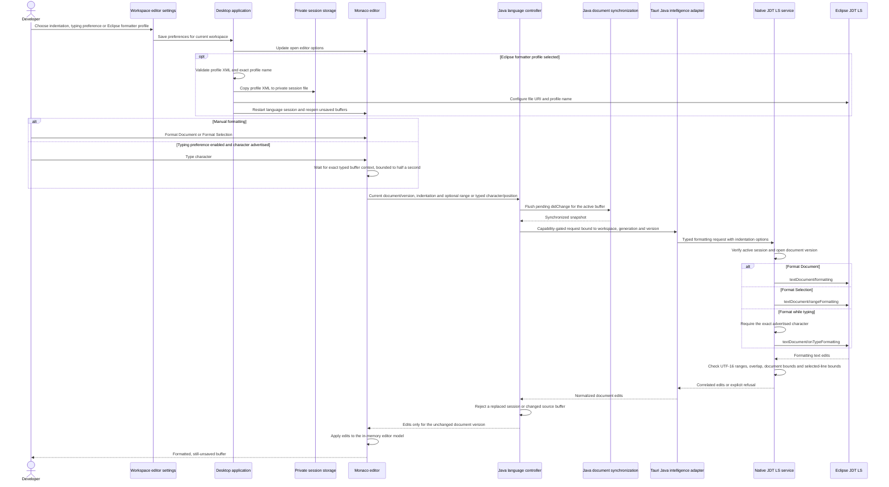

# Java Formatting Runtime

Implemented behavior and limitations: [ARC42 section 6.2](../../ARC42.md#62-editing-and-saving).
This interaction formats the active Java buffer through the initialized JDT LS session. It covers document formatting, selected-line formatting and optional formatting after typing a server-advertised character. Changes remain unsaved. Workspace settings control indentation, the typing preference and an optional Eclipse formatter profile; verification scope is maintained in ARC42.

