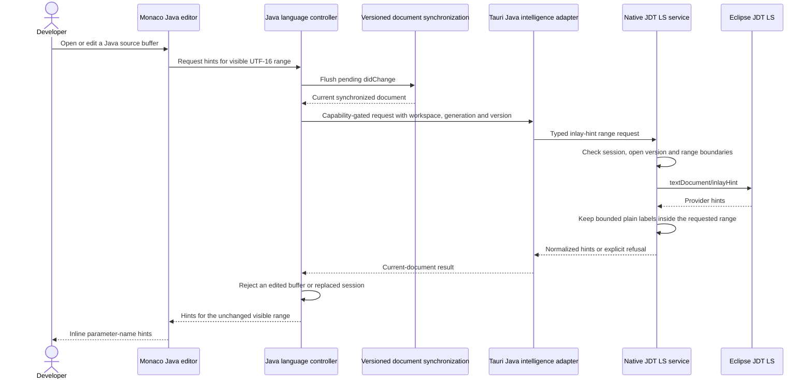

# Java Inlay Hints Runtime

Implemented behavior and limitations: [ARC42 section 5.2](../../ARC42.md#52-java-tooling) and [section 6.2](../../ARC42.md#62-editing-and-saving).

Monaco requests hints for the visible range of the active Java buffer. The controller flushes pending document changes and binds the request to the workspace, language-server generation and document version. The native service requires the negotiated JDT LS capability, validates UTF-16 positions against the synchronized document and requested range, removes provider tooltips and commands, and returns bounded plain-text labels. Current preferences show parameter names for literal arguments. Replies for an edited buffer or replaced session are discarded. Hints do not modify or save source.

The installed JDT LS smoke test verifies a literal-argument parameter hint. Monaco provider tests verify coordinate mapping and stale-reply suppression. A Linux release/no-bundle native GUI scenario confirms Monaco renders parameter labels beside literal arguments while leaving saved source unchanged. Installer and other operating-system coverage remains unavailable.

