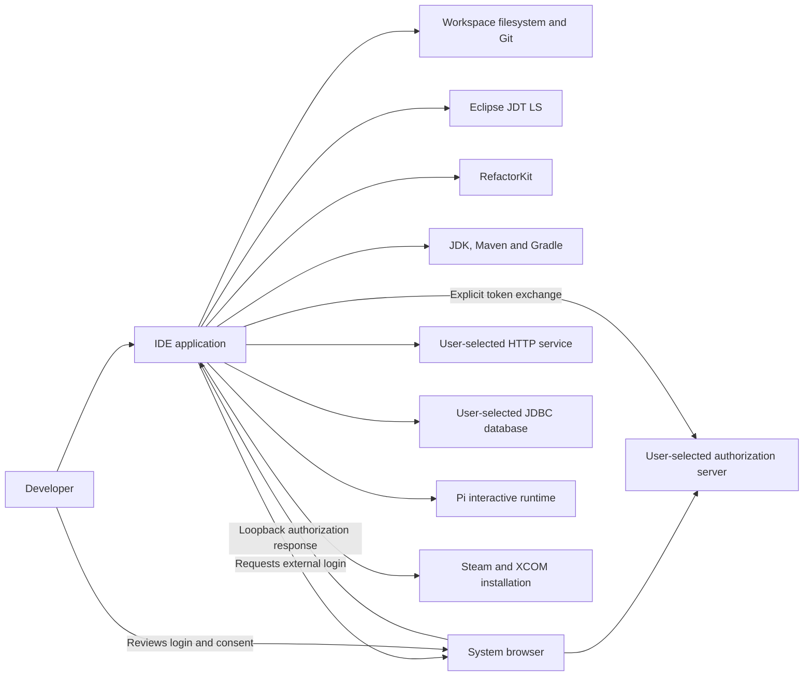

# C4 System Context

Architecture description: [ARC42 chapter 3](../../ARC42.md#section-3-system-context--external-actors).

Detailed model and relationships: [workspace.dsl](workspace.dsl), view `IdeSystemContext`.
