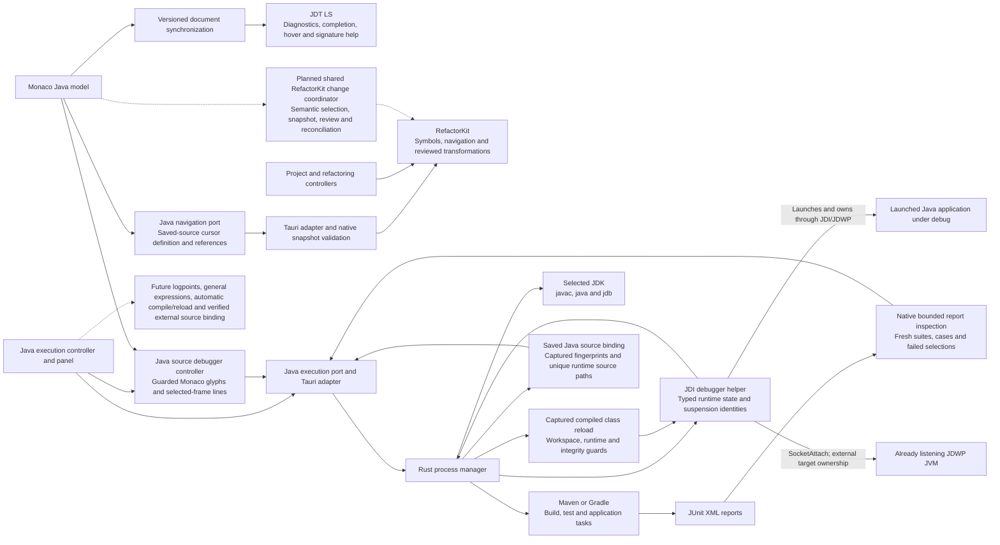

# Java Integration Diagram

Current behavior: [ARC42 section 5.2](../../ARC42.md#52-java-tooling). Execution and debugger scope: [section 6.3](../../ARC42.md#63-java-execution). Dotted relationships below are future work, not available providers.

Planned transformation workflow: [ARC42 section 8.4](../../ARC42.md#84-planned-shared-refactoring-workflow). Detailed model: [workspace.dsl](workspace.dsl), Java provider/component views. The filename is retained for existing links; this is an implementation diagram with an explicitly marked future extension.
