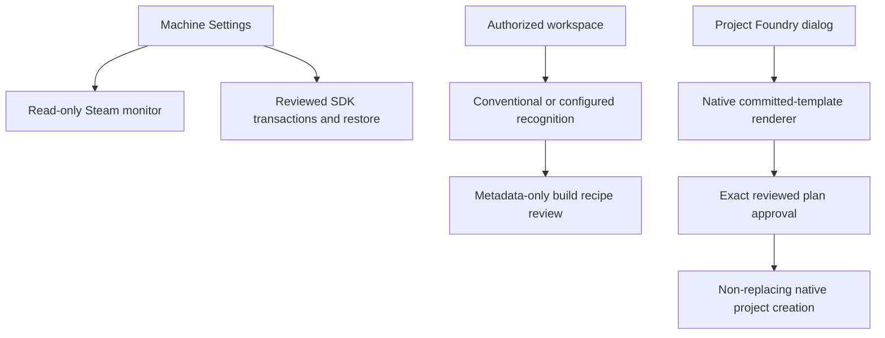

# XCOM Integration Diagram

Scope and limitations: [ARC42 section 5.3](../../ARC42.md#53-pi-and-first-party-xcom-features).

There is no recipe-execution edge: approval of metadata is not an executor. Detailed model: [workspace.dsl](workspace.dsl), XCOM recognition and Foundry views.
